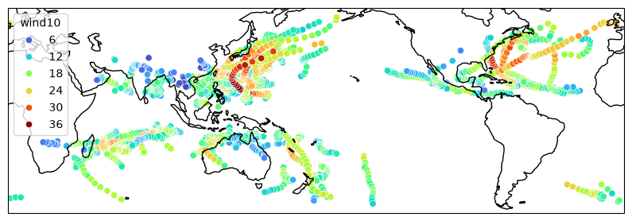

### HuracanPy is a python package for working with various forms of feature-tracking data, particularly cyclone tracks.  
  
#### Overview  

HuracanPy was developed as part of the [Huracán project](https://ourresearch.reading.ac.uk/huracan/) to provide a unified tool for working with output from feature-tracking algorithms. HuracanPy can read tracks from many different sources, and it provides functions to analyse tracks, including many common diagnostics. Its goal is to make track data analysis more accessible and promote good reproducibility practices.
  

#### Further information  
  
Bourdin and Safin, [HuracanPy: A Python package for reading and analysing cyclone tracks](https://doi.org/10.21105/joss.08174). *Journal of Open Source Software* **10**(111), 8174 (2025).  

---

[**HuracanPy GitHub**](https://github.com/Huracan-project/huracanpy)  
